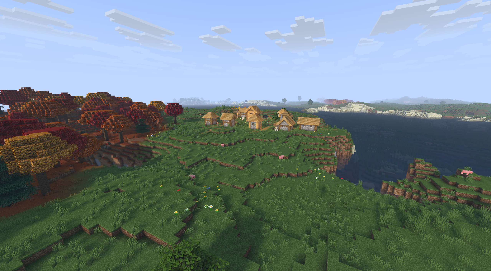
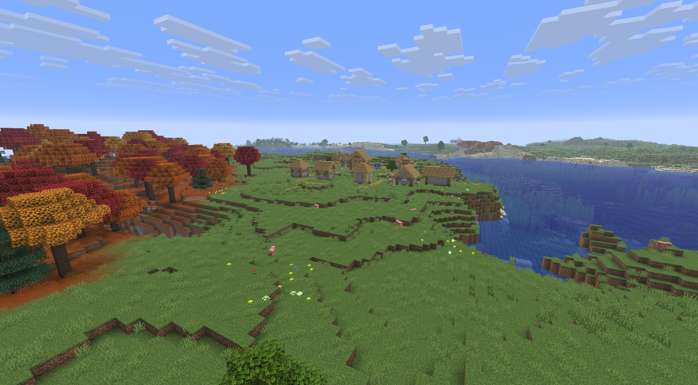

# Softbound Shader Pack

A work-in-progress Minecraft shader pack written in GLSL. The pack adds custom lighting and post-processing effects, with a focus on soft shadows, contact shading, and reflective water.

## Download

[Download Softbound on CurseForge](https://www.curseforge.com/minecraft/shaders/softbound) — 600+ downloads!

## Preview
<table>
  <tr>
    <th>With shader</th>
    <th>Without shader (vanilla)</th>
  </tr>
  <tr>
    <td></td>
    <td></td>
  </tr>
</table>

## Current effects

- Directional sunlight with shadow-map shadows and soft filtering.
- Screen-space ambient occlusion for subtle contact shading.
- Water reflections using screen-space ray marching, with a sky and sunlight fallback when a screen-space reflection is unavailable.
- Air, water, and lava fog.
- Gamma conversion in the final pass.
- Shader passes for terrain, entities, the player's hand, sky, clouds, weather, and other common render layers.

These effects are implemented directly in the shader source. There is currently no shader options menu or configuration file in this folder.

## Manual install

1. Use a Minecraft shader loader that supports the shader-pack format and the uniforms used by these shaders. Compatibility has not yet been verified across Minecraft versions or loaders.
2. Copy this project folder into the instance's `shaderpacks` directory. The folder you copy should contain this `README.md` and the `shaders/` directory.
3. Launch Minecraft, open the shader pack menu provided by your loader, and select the pack.

In this workspace, the project is already located under `shaderpacks`. If the loader does not list it, check that the folder nesting is `shaderpacks/<pack name>/shaders/...` and not `shaderpacks/<pack name>/<pack name>/shaders/...`.
